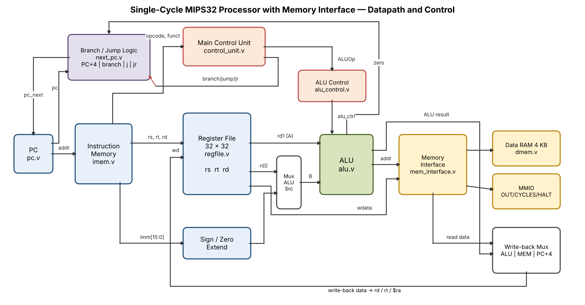
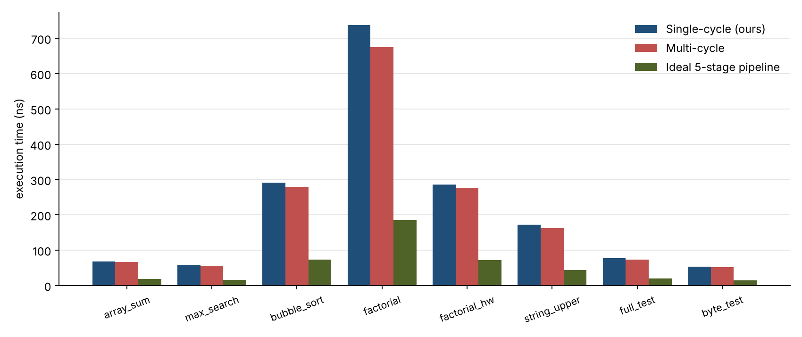
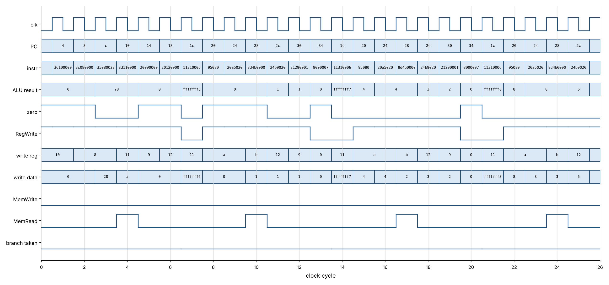

# Single-Cycle MIPS32 Processor with Memory Interface

**Modern Computer Architecture (MCA) — Project 2** · B.Tech CS&AI · Newton School of Technology, Rishihood University

A 32-bit single-cycle MIPS processor written in synthesizable Verilog. It runs **34 MIPS32 instructions** (including byte/halfword loads and stores and a hardware `mul`) and includes a **memory interface** that decodes every load/store address, sends it to a 4 KB data RAM or to memory-mapped I/O registers, and handles byte lanes, byte enables and alignment.

| | |
|---|---|
| 📄 **Final IEEE report (Phase II)** | [`report/IEEE_Report_Final.pdf`](report/IEEE_Report_Final.pdf) |
| 📄 Phase I IEEE report | [`report/IEEE_Report_Phase1.pdf`](report/IEEE_Report_Phase1.pdf) |
| 📊 Performance study | [`docs/perf_results.md`](docs/perf_results.md) |
| 🎥 Prototype demo video |https://drive.google.com/drive/folders/1rhn3lwi_-24imqKGfuRqZ_glGERA07Sn?usp=sharing |
| 🧭 Datapath diagram | [`docs/images/datapath.png`](docs/images/datapath.png) |

## Team

| Member | Roll No. | Responsibility |
|---|---|---|
| **Keshav Rajput** (Lead) | 2401010222 | Architecture, control unit, ALU control, core integration + write-back, system testbench, synthesis, report |
| **Mayank Gupta** | 2401010267 | ALU, register file, sign/zero extension + unit tests |
| **Gaurav Meena** | 2401010169 | PC, instruction memory, data memory, memory interface (MMIO) + test |
| **Aaryan Gera** | 2401010009 | Branch/jump logic, assembler, test programs, regression + waveform scripts |

## Architecture



Each instruction is fetched, decoded, executed, accesses memory and writes back in **one clock cycle (CPI = 1)**.

### Instruction set (34)

| Type | Instructions |
|---|---|
| R | `add addu sub subu and or xor nor slt sltu sll srl sra jr` |
| I | `addi addiu andi ori xori slti lui lw sw beq bne` |
| I (Phase II) | `lb lbu lh lhu sb sh` |
| SPECIAL2 (Phase II) | `mul` |
| J | `j jal` |

### Memory map (memory interface)

| Address | Region | Access |
|---|---|---|
| `0x0000_0000 – 0x0000_0FFF` | Data RAM (1024 words) | R/W |
| `0x0000_FFF0` | `IO_OUT` – output port | W (R) |
| `0x0000_FFF8` | `IO_CYCLES` – cycle counter | R |
| `0x0000_FFFC` | `IO_HALT` – stop CPU | W |

`$sp` resets to `0x0FFC` (top of RAM).

## Repository layout

```
rtl/        Verilog RTL (12 modules + defines.vh)
tb/         unit testbenches + system testbench
programs/   MIPS assembly test programs (.s)
scripts/    assembler, regression runner, waveform + diagram scripts
synth/      Yosys script and synthesis reports
docs/       diagrams, waveforms, video script, team workflow
report/     IEEE report (LaTeX source + PDF)
```

## Running it

Requirements: `iverilog`, `python3`, optional `gtkwave`, `yosys`.

```bash
make test                     # all unit tests + all programs (regression)
make run  PROG=factorial      # run one program, prints IO_OUT values
make wave PROG=array_sum      # open the waveform in GTKWave
make synth                    # Yosys synthesis -> synth/report_*.txt
python3 scripts/mips_asm.py programs/array_sum.s -o programs/build   # assemble only
```

## Results

| Program | What it tests | Output | Cycles |
|---|---|---|---|
| `full_test.s` | every instruction, self-checking | `0x600D` (pass) | 97 |
| `array_sum.s` | loop, lw, sll addressing | 55 | 85 |
| `max_search.s` | signed compare, slt | 97 | 73 |
| `factorial.s` | recursion, jal/jr, stack | 1 2 6 24 120 720 5040 | 922 |
| `bubble_sort.s` | nested loops, lw/sw | -7 0 3 9 15 22 41 88 | 364 |
| `byte_test.s` *(II)* | lb/lbu/lh/lhu/sb/sh/mul, self-checking | `0x600D` (pass) | 66 |
| `string_upper.s` *(II)* | string to upper case with lbu/sb | 18, 1218 | 216 |
| `factorial_hw.s` *(II)* | factorial with hardware `mul` | 1 2 6 24 120 720 5040 | 357 |

Unit tests: ALU (20), register file (66), control unit (22), next-PC (7), memory interface incl. sub-word: **all pass**.
Mutation check: breaking `sra` makes `full_test` report `0xBAD00005` (the shift test).

**Synthesis (Yosys, Xilinx 7-series, core only):** ~1,660 LUTs, 1,024 FFs (register file), 38 CARRY4, 3 DSP48E1 (multiplier). Critical path ≈ 80 gate levels (PC → register file → ALU → zero → next PC).

### Phase II performance study

| | Single-cycle (ours) | Multi-cycle | Ideal 5-stage pipeline |
|---|---|---|---|
| Total time, 8 programs | 1744 ns | 1641 ns (1.06× faster, avg CPI ≈ 3.8) | 442 ns (3.94× faster) |

Hardware `mul` vs software multiply (factorial): **922 → 357 instructions, 2.58× faster.**





## References
Patterson & Hennessy, *Computer Organization and Design*; Harris & Harris, *Digital Design and Computer Architecture*; MIPS32 Architecture for Programmers Vol. II. Full list in the report.
